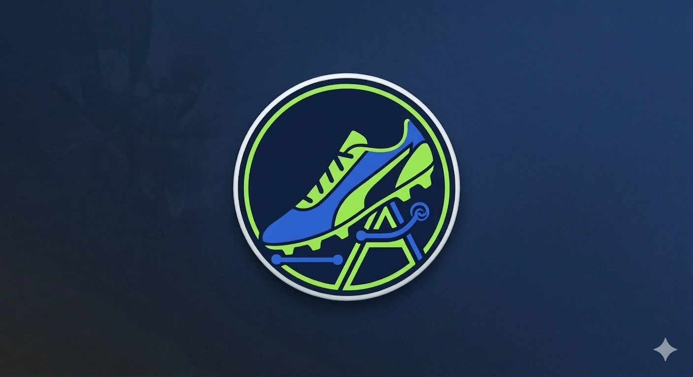
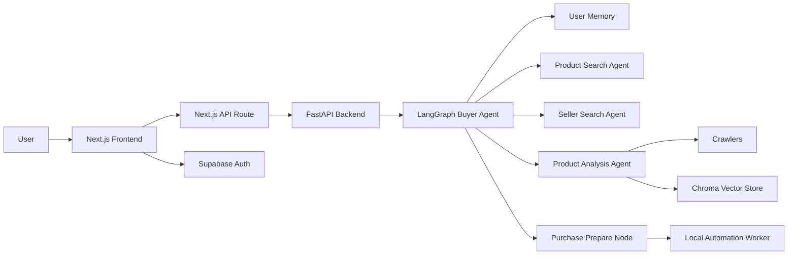
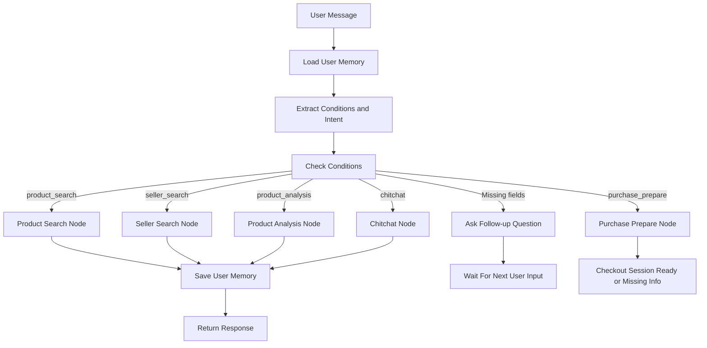
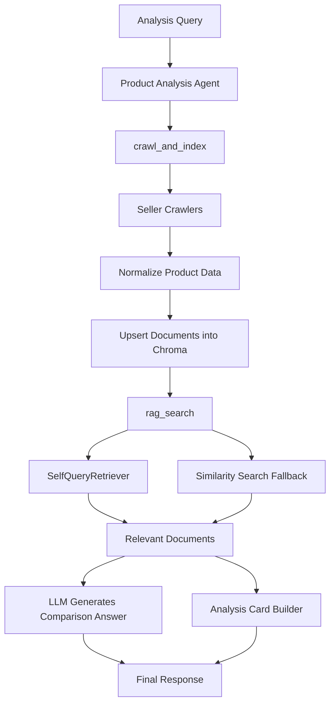

# Buyer Agent SaaS

축구화 구매 탐색을 대화형 AI Agent 워크플로우로 풀어낸 포트폴리오 프로젝트입니다.

사용자는 자연어로 원하는 조건을 말하고, Buyer Agent는 조건 추출, 후속 질문, 상품 추천, 판매처 탐색, 상품 비교 분석, 구매 준비 단계까지 이어서 처리합니다. 단순히 한 번 답변하는 챗봇이 아니라, 현재 상태와 사용자 조건을 기반으로 다음 작업을 결정하는 구매 Agent를 구현하는 데 초점을 맞췄습니다.

## Demo

[](DEMO_VIDEO_URL)

- Demo Video: [영상 보기](DEMO_VIDEO_URL)
- 핵심 흐름: 사용자 조건 입력 -> Agent 분석 -> 상품/판매처 추천 -> 비교 분석 -> 구매 준비

## Key Contributions

- `LangGraph` 기반 Buyer Agent를 설계해 상품 추천, 판매처 탐색, 상품 분석, 구매 준비를 상태 기반 워크플로우로 오케스트레이션
- `FastAPI + Next.js` 구조에서 `SSE` 스트리밍 응답을 연결해 Agent 진행 상태와 결과를 실시간으로 제공
- `crawl_and_index -> Chroma -> rag_search`로 이어지는 Agentic RAG 파이프라인을 구축해 크롤링 기반 상품 데이터를 분석 흐름에 연결
- 사용자 조건 추출, 후속 질문 생성, 사용자 메모리 저장을 결합해 불완전한 입력에서도 이어지는 상담형 구매 흐름 구현
- checkout session과 로컬 자동화 워커를 분리해 결제 직전 승인 경계를 명확히 둔 구매 준비 흐름 구현

## Why I Built This

축구화 구매는 검색 한 번으로 끝나지 않습니다.

- 예산, 포지션, 지면 조건에 맞는 모델을 먼저 좁혀야 합니다.
- 판매처별 가격, 사이즈, 재고를 따로 확인해야 합니다.
- 추천 결과가 나와도 왜 그 모델이 적합한지 설명이 필요합니다.
- 구매 직전에는 제품 선택, 사이즈, 배송 정보를 다시 정리해야 합니다.

이 프로젝트는 이 과정을 "검색 결과를 보여주는 챗봇"이 아니라, 사용자의 조건과 대화 상태를 바탕으로 다음 단계를 이어가는 Buyer Agent로 다루기 위해 만들었습니다.

## What It Does

- Next.js 기반 랜딩 페이지와 대시보드
- Supabase Google OAuth 로그인
- 사용자별 대화 히스토리 관리
- FastAPI 기반 AI 백엔드
- LangGraph 기반 intent 분기와 상태 전이
- 조건 부족 시 후속 질문 생성
- 상품 추천, 판매처 탐색, 상품 분석 Agent 분리
- RAG 기반 상품 비교 분석
- 구매 준비 정보 수집 및 checkout session 생성
- 결제 직전 단계까지 로컬 브라우저 자동화 준비

## Core Design

### 1. Stateful Agent Workflow

핵심 흐름은 LangGraph로 구성했습니다. 단일 프롬프트 앱이 아니라, 현재 의도, 누적 조건, 이전 검색 결과, 사용자 메모리, 구매 상태를 함께 다룹니다.

주요 노드는 다음과 같습니다.

- `load_user_memory`
- `extract_conditions_and_intent`
- `check_conditions`
- `ask_missing_node`
- `product_search_node`
- `seller_search_node`
- `product_analysis_node`
- `purchase_prepare_node`
- `save_user_memory`

추천, 판매처 탐색, 비교 분석, 구매 준비는 서로 다른 책임을 갖습니다. 이를 한 번의 모델 호출에 밀어 넣으면 디버깅과 확장이 어려워지기 때문에, 상태 그래프 기반으로 각 단계를 분리했습니다.

### 2. Incomplete Input Handling

사용자는 처음부터 모든 조건을 입력하지 않습니다. 그래서 메시지에서 조건을 구조화해 추출하고, 부족한 슬롯은 다시 질문하는 흐름을 넣었습니다.

- 예산, 브랜드, 지면, 포지션, 연령대, 상품명, 판매처 추출
- 부족한 필드는 질문 시퀀스로 보완
- 후속 답변은 기존 조건과 병합
- 조건이 충분해지면 적절한 Agent node로 이동

검색창보다 상담형 인터페이스에 가까운 UX를 목표로 했습니다.

### 3. Streaming-first UX

프론트는 완성된 결과를 한 번에 받지 않습니다. Next.js API route가 FastAPI `/chat/stream`에 연결되고, 백엔드는 SSE로 진행 상태와 최종 결과를 순차적으로 반환합니다.

이 구조를 통해 사용자 화면에는 다음이 함께 나타납니다.

- 현재 어떤 단계가 실행 중인지
- 응답이 스트리밍 중인지
- 최종 결과에 어떤 카드 데이터가 붙는지

검색, 크롤링, 분석이 함께 걸리는 구매 탐색 작업에서는 최종 답변만큼이나 진행 상태를 보여주는 것이 중요하다고 판단했습니다.

### 4. Approval-Bounded Automation

구매 자동화는 결제 완료까지 밀어붙이지 않고, 결제 직전 승인 경계를 명확히 둔 구조로 설계했습니다.

- Agent는 구매 준비에 필요한 상품, 사이즈, 배송 정보를 수집합니다.
- Backend는 checkout session payload를 생성합니다.
- Local Automation Worker는 브라우저 자동화를 통해 주문 직전 단계까지 준비합니다.
- 최종 결제 제출 전에는 사용자의 명시적 승인을 요구합니다.

자동화 기능에서 중요한 것은 "얼마나 많이 자동화하는가"보다 "어디서 멈추고 사용자에게 통제권을 돌려주는가"라고 판단했습니다.

## System Architecture



핵심은 프론트가 orchestration 세부사항을 직접 알지 않고 API route만 바라보게 만든 점입니다. 상품 분석은 단순 LLM 호출이 아니라 crawler와 vector store를 거치는 별도 서브시스템으로 분리했습니다.

## Buyer Agent Flow



이 흐름은 "챗봇이 대답한다"보다 "현재 상태에 맞는 작업 노드로 라우팅한다"는 관점에서 보는 편이 정확합니다.

## RAG Pipeline

상품 비교 분석은 단순히 LLM에 "비교해줘"라고 묻는 방식이 아니라, `crawl_and_index`와 `rag_search`를 묶은 파이프라인 위에서 동작합니다.



구현 포인트는 아래와 같습니다.

- 크롤링과 검색을 분리
- 상품 데이터를 `Document + metadata` 형태로 적재
- 판매처, 가격, 카테고리, 지면 조건을 retrieval metadata로 활용
- retrieval 실패 시 similarity search fallback 사용
- 최종 텍스트 응답과 별개로 프론트에서 바로 쓸 수 있는 analysis card 데이터 생성

## Tech Stack

### Frontend

- Next.js
- React
- TypeScript
- Tailwind CSS
- Supabase Auth
- Framer Motion

### Backend

- FastAPI
- LangChain
- LangGraph
- OpenAI API
- ChromaDB
- Python

### Automation / Infra

- SSE Streaming
- Supabase
- Local Automation Worker
- Docker

## Interview Talking Points

이 프로젝트는 기능 목록보다 아래 설계 판단을 중심으로 설명하는 편이 좋습니다.

- 왜 state graph로 구매 흐름을 분해했는가
- 왜 분석 단계를 crawler, vector store, retrieval로 분리했는가
- 왜 SSE 기반 진행 상태 노출이 필요한가
- 왜 사용자 메모리와 구매 준비 단계를 별도로 뒀는가
- 왜 자동화가 결제 직전 승인 경계에서 멈춰야 하는가

## Development Notes

포트폴리오용 프로젝트이지만, 로컬 실행은 아래 흐름으로 가능합니다.

```bash
# frontend
cd frontend
npm install
npm run dev

# backend
cd backend
pip install -r requirements.txt
uvicorn FastAPI.main:app --reload --port 8000
```

주요 환경 변수는 다음과 같습니다.

```env
OPENAI_API_KEY=
NEXT_PUBLIC_SUPABASE_URL=
NEXT_PUBLIC_SUPABASE_PUBLISHABLE_KEY=
NEXT_PUBLIC_BACKEND_URL=http://127.0.0.1:8000
```

테스트는 백엔드 기준으로 실행합니다.

```bash
cd backend
python -m unittest discover Test
```

주요 테스트 범위는 조건 정규화, 판매처 이름 정규화, FastAPI 응답 변환, 구매 준비 그래프 흐름, checkout session 생성입니다.

## What I Learned

- LLM 기능을 제품 흐름으로 만들려면 프롬프트보다 상태 설계가 더 중요했습니다.
- 사용자가 조건을 완성해서 입력하지 않는다는 전제에서 후속 질문 흐름을 설계해야 했습니다.
- 긴 Agent 작업에서는 최종 응답뿐 아니라 진행 상태 스트리밍이 UX에 큰 영향을 줬습니다.
- RAG는 답변 품질뿐 아니라 프론트에서 바로 사용할 구조화 데이터를 만드는 방식까지 함께 설계해야 했습니다.
- 자동화 기능은 가능한 많은 동작을 대신 수행하는 것보다 승인 경계를 명확히 두는 것이 더 중요했습니다.

## Limitations & Next Steps

- RAG 검색 품질 평가 체계 보강
- crawler 실패 케이스와 데이터 품질 이슈 대응 강화
- Agent node 단위 테스트 확대
- checkout automation 지원 판매처 확장
- 실험 코드와 제품 코드의 분리
