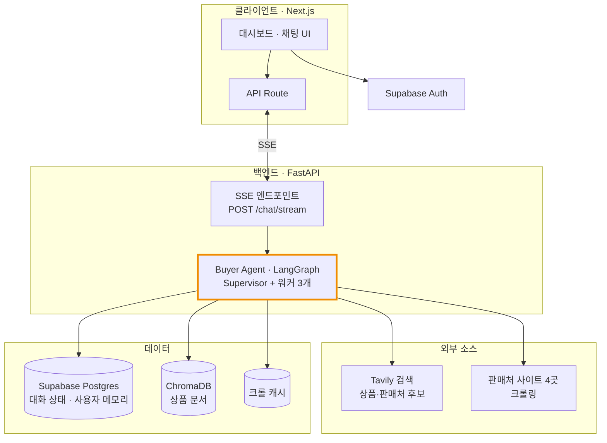
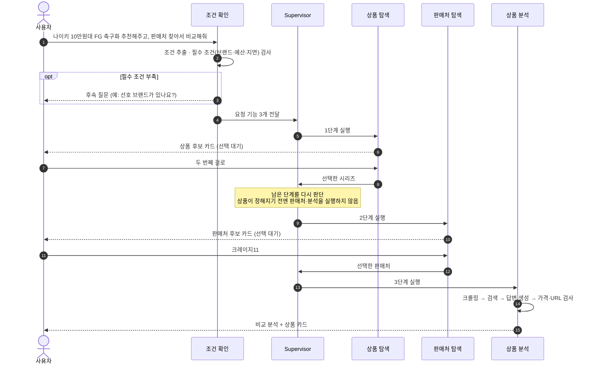
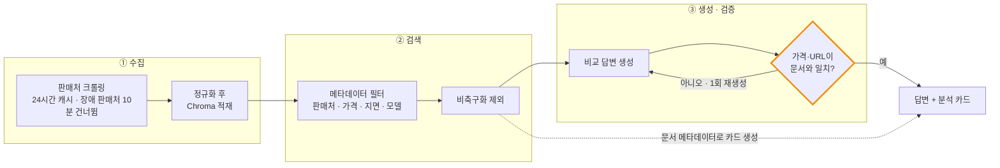
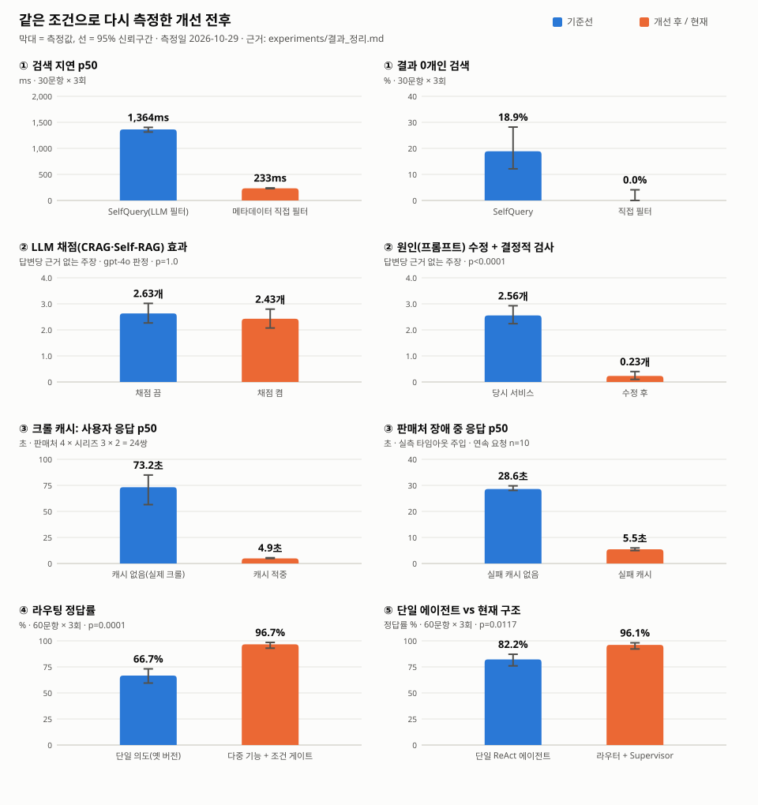

# Buyer Agent SaaS

축구화 구매 탐색을 대화형 AI Agent 워크플로우로 풀어낸 포트폴리오 프로젝트입니다.

사용자는 자연어로 원하는 조건을 말하고, Buyer Agent는 조건 추출, 후속 질문, 상품 추천, 판매처 탐색, 상품 비교 분석까지 이어서 처리합니다. 단순히 한 번 답변하는 챗봇이 아니라, 현재 상태와 사용자 조건을 기반으로 다음 작업을 결정하는 구매 Agent를 구현하는 데 초점을 맞췄습니다.

**핵심 결과** (개선 전 코드와 같은 질문·조건으로 재측정, 상세는 [Evaluation](#evaluation))

- 라우팅 정답률 66.7% → **96.7%** (처음 보는 질문 기준 90.0%)
- 상품 분석 응답 p50 73.2초 → **4.9초**, 검색 p50 1,364ms → **233ms**
- 답변당 근거 없는 주장 2.56 → **0.23개**, 평가 과정에서 찾은 서비스 버그 8건 수정 및 회귀 테스트로 고정

## Demo

https://github.com/user-attachments/assets/68ed86c8-f8c9-4a0a-825c-842ac4a33fc2

- 핵심 흐름: 사용자 조건 입력 -> Agent 분석 -> 상품/판매처 추천 -> 비교 분석

## Why I Built This

축구화 구매는 검색 한 번으로 끝나지 않습니다.

- 예산, 포지션, 지면 조건에 맞는 모델을 먼저 좁혀야 합니다.
- 판매처별 가격, 사이즈, 재고를 따로 확인해야 합니다.
- 추천 결과가 나와도 왜 그 모델이 적합한지 설명이 필요합니다.

이 프로젝트는 이 과정을 "검색 결과를 보여주는 챗봇"이 아니라, 사용자의 조건과 대화 상태를 바탕으로 다음 단계를 이어가는 Buyer Agent로 다루기 위해 만들었습니다.

## Key Contributions

- `LangGraph` 기반 Buyer Agent를 설계하고, supervisor가 매 단계 다음 작업을 다시 판단하는 구조로 상품 추천·판매처 탐색·상품 분석을 오케스트레이션
- `FastAPI + Next.js` 구조에서 `SSE` 스트리밍 응답을 연결해 Agent 진행 상태와 결과를 실시간으로 제공
- `crawl_and_index -> Chroma -> rag_search`로 이어지는 Agentic RAG 파이프라인을 구축해 크롤링 기반 상품 데이터를 분석 흐름에 연결
- 사용자 조건 추출, 후속 질문 생성, 사용자 메모리 저장을 결합해 불완전한 입력에서도 이어지는 상담형 구매 흐름 구현
- 개선마다 개선 전 코드와 같은 질문·조건으로 다시 측정하는 평가 체계(`experiments/`)를 만들고, 그 과정에서 서비스 버그 8건을 찾아 수정

## Architecture

### System



프론트는 orchestration 세부사항을 모르고 API route만 바라봅니다. 대화 상태(체크포인트)와 사용자 메모리는 Postgres에 저장합니다.

### Buyer Agent Flow

"나이키 10만원대 FG 축구화 추천해주고, 판매처 찾아서 비교해줘"라는 한 문장이 처리되는 과정입니다.



- supervisor는 워커가 끝날 때마다 남은 단계를 다시 판단합니다(한 턴 최대 3단계). 상품이 정해지지 않았는데 판매처나 분석이 먼저 선택되면 코드로 순서를 바로잡습니다.
- 워커는 후보가 나오면 LangGraph `interrupt`로 멈추고 사용자의 선택을 기다립니다. "두 번째 걸로" 같은 선택뿐 아니라 "다른 거 보여줘", 조건 변경, 질문도 자연어로 처리합니다.
- "모두 비교해줘"처럼 판매처를 고를 필요가 없는 요청은 선택 단계를 건너뜁니다.

## Core Design

### 1. Stateful Agent Workflow

단일 프롬프트 앱이 아니라, 현재 의도, 누적 조건, 이전 검색 결과, 사용자 메모리를 그래프 상태로 함께 다룹니다.

추천, 판매처 탐색, 비교 분석은 서로 다른 책임을 갖습니다. 이를 한 번의 모델 호출에 밀어 넣으면 디버깅과 확장이 어려워지기 때문에, 상태 그래프 기반으로 각 단계를 분리했습니다.

### 2. Incomplete Input Handling

사용자는 처음부터 모든 조건을 입력하지 않습니다. 그래서 메시지에서 조건을 구조화해 추출하고, 부족한 슬롯은 다시 질문하는 흐름을 넣었습니다.

- 예산, 브랜드, 지면, 포지션, 연령대, 상품명, 판매처 추출
- 부족한 필드는 질문 시퀀스로 보완
- 후속 답변은 기존 조건과 병합
- 조건이 충분해지면 supervisor로 이동

검색창보다 상담형 인터페이스에 가까운 UX를 목표로 했습니다.

### 3. Streaming-first UX

프론트는 완성된 결과를 한 번에 받지 않습니다. Next.js API route가 FastAPI `/chat/stream`에 연결되고, 백엔드는 SSE로 진행 상태와 최종 결과를 순차적으로 반환합니다.

- 현재 어떤 단계가 실행 중인지
- 응답이 스트리밍 중인지
- 최종 결과에 어떤 카드 데이터가 붙는지

검색, 크롤링, 분석이 함께 걸리는 구매 탐색 작업에서는 최종 답변만큼이나 진행 상태를 보여주는 것이 중요하다고 판단했습니다.

## RAG Pipeline

상품 비교 분석은 단순히 LLM에 "비교해줘"라고 묻는 방식이 아니라, `crawl_and_index`와 `rag_search`를 묶은 파이프라인 위에서 동작합니다.



- 크롤링과 검색을 분리하고, 같은 요청은 24시간 크롤 캐시·장애 판매처는 10분 실패 캐시로 건너뜀
- 상품 데이터를 `Document + metadata` 형태로 적재
- 앞 단계에서 확정한 판매처·가격·지면·모델 조건을 LLM 없이 Chroma 메타데이터 필터로 바로 적용
- 답변 생성 프롬프트는 `backend/prompts/`에 버전과 변경 근거를 남겨 관리하고, 답변의 가격·URL은 코드로 문서와 대조(실패 시 1회 재생성)
- 최종 텍스트 응답과 별개로 프론트에서 바로 쓸 수 있는 analysis card 데이터 생성

## Evaluation

개선 전후를 **같은 질문·같은 모델·같은 조건**으로 다시 측정했습니다. 막대는 측정값, 선은 95% 신뢰구간입니다.

<picture>
  <source media="(prefers-color-scheme: dark)" srcset="docs/images/experiments-dark.svg">
  
</picture>

| # | 바꾼 것 | 결과 | 표본 |
|---|---|---|---|
| ① | 검색 필터: LLM이 매번 만들던 필터(SelfQuery) → 메타데이터 직접 필터 | 검색 p50 1,364ms → **233ms**, 결과 0개 17/90 → **0/90** | 30문항 × 3회 |
| ② | LLM 채점(CRAG·Self-RAG) 검증 → 효과 없음(p=1.0) 확인, 원인인 생성 프롬프트 한 줄 수정 + 결정적 검사로 교체 | 답변당 근거 없는 주장 2.56 → **0.23개**, LLM 호출 3 → 1회 | 30문항 × 2회 |
| ③ | 크롤 캐시 재측정 + 판매처 장애용 실패 캐시 | 응답 p50 73.2초 → **4.9초**, 장애 중 28.6초 → **5.5초** | 24쌍 / 장애 주입 |
| ④ | 라우팅: 단일 의도 → 다중 기능 + 조건 게이트 | 정답률 66.7% → **96.7%** (p=0.0001) | 60문항 × 3회 |
| ⑤ | 같은 프롬프트·규칙의 단일 ReAct 에이전트와 비교 | 현재 구조 **96.1%** vs 단일 에이전트 82.2% (p=0.0117) | 60문항 × 3회 |

<details>
<summary><b>평가 방법</b></summary>

개선 전 코드는 git 기록에서 복원하거나 해당 단계만 끈 상태로 같은 조건에서 실행했습니다. 가격·링크·조건 만족은 코드로 대조했고, 근거 없는 주장은 생성 모델과 다른 모델(gpt-4o)이 어느 방식의 답변인지 모르는 상태로 판정한 뒤 표본을 사람이 검수했습니다. 비교는 질문 단위 짝 검정입니다.

</details>

<details>
<summary><b>평가로 찾은 버그 8건</b></summary>

- 문서에 없는 기능 설명을 요구하던 생성 프롬프트
- 정상 문서를 지우던 CRAG
- "10만원대" 오해로 생긴 거짓 "결과 없음"
- 신가드·축구공에 밀려 축구화가 0건이 되던 검색
- 장애 중 매 요청 타임아웃 대기
- HG·"퓨처" 조건 누락
- 분석을 상품 탐색보다 먼저 실행하던 supervisor
- "TF용"처럼 한글이 붙은 지면을 놓치던 분석 에이전트

모두 회귀 테스트로 고정했습니다.

</details>

<details>
<summary><b>처음 보는 질문으로 한 과적합 확인</b></summary>

평가셋과 겹치지 않는 질문(분석 30·라우팅 30)으로 다시 쟀습니다. 분석은 같은 수준(근거 없는 주장 0.28개)이 나왔고 새 버그 1건을 더 찾았습니다. 라우팅은 90.0%로 평가셋(96.7%)보다 낮았고, 단일 에이전트와의 차이도 92.2% vs 87.8%로 줄어(p=0.5) ⑤의 결론은 "다중 기능 요청(100% vs 72%)과 필수 조건 규칙에서 낫다"로 좁혀 말합니다.

</details>

<details>
<summary><b>평가의 한계</b></summary>

질문은 직접 작성(검색·분석은 실제 DB 조합에서 규칙 생성)했고, 판정자 LLM의 오판이 있어 ②의 최종값은 상한입니다. 실패 캐시는 실측 타임아웃을 주입한 측정입니다.

</details>

상세 결과는 [`experiments/결과_정리.md`](experiments/결과_정리.md)에 정리했습니다.

## Tech Stack

| 영역 | 기술 |
|---|---|
| Frontend | Next.js, React, TypeScript, Tailwind CSS, Framer Motion |
| Backend | Python, FastAPI, LangGraph, LangChain, OpenAI API |
| Data / RAG | ChromaDB, 판매처 크롤러 |
| Infra | Supabase (Auth), SSE, Docker |

## Getting Started

```bash
# frontend
cd frontend
npm install
npm run dev

# backend
cd backend
pip install -r requirements.txt
uvicorn FastAPI.main:app --reload --port 8000
```

주요 환경 변수는 다음과 같습니다.

```env
OPENAI_API_KEY=
NEXT_PUBLIC_SUPABASE_URL=
NEXT_PUBLIC_SUPABASE_PUBLISHABLE_KEY=
NEXT_PUBLIC_BACKEND_URL=http://127.0.0.1:8000
```

테스트는 백엔드 기준으로 실행합니다.

```bash
cd backend
python -m unittest discover Test -p "test_*.py"
```

조건 정규화, supervisor·워커 라우팅, 캐시, 크롤러 정규화, FastAPI 응답·진행 이벤트 등을 172개 테스트로 확인합니다.

## What I Learned

- LLM 기능을 제품 흐름으로 만들려면 프롬프트보다 상태 설계가 더 중요했습니다.
- 사용자가 조건을 완성해서 입력하지 않는다는 전제에서 후속 질문 흐름을 설계해야 했습니다.
- 긴 Agent 작업에서는 최종 응답뿐 아니라 진행 상태 스트리밍이 UX에 큰 영향을 줬습니다.
- RAG는 답변 품질뿐 아니라 프론트에서 바로 사용할 구조화 데이터를 만드는 방식까지 함께 설계해야 했습니다.

## Limitations & Next Steps

- 크롤 단계 상품 분류 개선 필요(현재 비축구화를 상품명 키워드로 제외, 연령대·사이즈 메타데이터 오류 존재)
- 평가 질문 사람 검수와 실사용 로그 기반 평가(캐시 적중률, 가격 신선도)
- 실패 캐시를 워커 간 공유 저장소로 이동(현재 프로세스 메모리)
