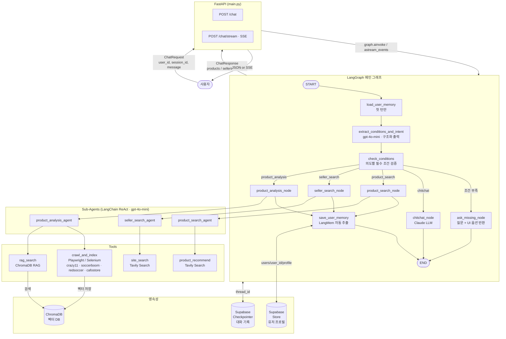

# 인터뷰 형식
- 작업을 수행하는 과정에서 모르거나 애매한 게 있으면 인터뷰 형식 (카드 형식)으로 질문해주세요.

---

# Buyer Agent SaaS - Backend

## Overview
LangGraph + FastAPI 기반 AI 쇼핑 에이전트. 사용자 조건 수집 → 상품/판매자 크롤링 → RAG 검색 → 분석 결과 반환.

## Entry Point
- 실행: `uvicorn FastAPI.main:app --reload`
- API 서버: `FastAPI/main.py`

## Tech Stack
- Agent: LangGraph + LangMem (개인화)
- LLM: Claude (Anthropic)
- API: FastAPI + SSE 스트리밍
- Vector DB: ChromaDB (RAG)
- Scraping: Playwright, Selenium, Firecrawl
- Korean NLP: KoNLPy, Kiwi

## Architecture

## Folder Map
각 폴더의 Claude.md에 상세 내용 있음.
- `Agent/` → LangGraph 에이전트 구현
- `Tools/` → 도구 함수 (RAG, 크롤링, 정규화)
- `FastAPI/` → REST API 서버
- `State/` → AgentState 정의
- `Crawling/` → 셀러 크롤러
- `Test/` → 테스트

## Class-Based / OOP Structure
백엔드는 함수형 LangGraph 노드와 클래스 기반 컴포넌트를 함께 사용한다.
루트 문서에는 주요 책임만 요약하고, 상세 구현은 각 폴더/파일의 코드 기준으로 확인한다.

### 주요 클래스 영역
- `FastAPI/main.py`
  - `ChatRequest`, `ChatResponse` → API 입출력 Pydantic 모델
- `State/`
  - `BuyerAgentStateV2`, `SearchResultItem`, `UserProfile` → LangGraph 상태와 사용자 프로필 타입
- `Agent/`
  - `ExtractedConditions`, `ExtractionResult`, `ParsedProducts`, `ParsedSellers`, `ParsedAnalysis` → LLM 구조화 출력 모델
- `Tools/checkout_adapter.py`
  - `CheckoutFlowDefinition` → 판매자별 결제 플로우 정의
  - `CheckoutAdapter` → 결제 세션 생성 기본 인터페이스
  - `Crazy11CheckoutAdapter` → 크레이지11 전용 결제 플로우 구현
- `AutomationWorker/`
  - `AutomationCommandRunner` → 브라우저 자동화 명령 실행 추상화
  - `AgentBrowserCommandRunner` → `agent-browser` 기반 실행기
  - `CheckoutAutomationDriver` → 결제 자동화 드라이버 인터페이스
  - `Crazy11AgentBrowserDriver` → 크레이지11 결제 자동화 구현
  - `LocalAutomationService` → 결제 준비/승인/완료 흐름 조율 서비스

### OOP 작성 규칙
- 공통 인터페이스/추상 클래스는 `ABC` 기반으로 정의한다.
- 판매자별 차이는 하위 클래스 또는 어댑터로 분리한다.
- API/Agent 계층은 직접 브라우저 자동화를 수행하지 않고 서비스/드라이버 계층을 호출한다.
- 루트 `Claude.md`에는 전체 구조만 기록하고, 상세 변경은 관련 코드와 폴더 문서에 맞춰 관리한다.

## Conventions
- 한국어 주석 사용

## 자동 업데이트 규칙 (필수)
작업이 끝날 때마다 반드시 아래 두 파일을 업데이트할 것:

1. **해당 폴더의 `TODO.md`**
   - 작업한 내용 → `- [x]` 완료 항목으로 추가
   - 발견한 버그 / 남은 작업 → `- [ ]`로 추가

2. **해당 폴더의 `Claude.md`**
   - 새로운 파일이 생겼거나 구조가 바뀌었을 때만 업데이트
   - 변경 없으면 그대로 둘 것
